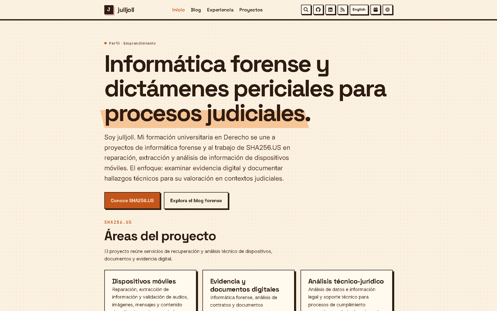
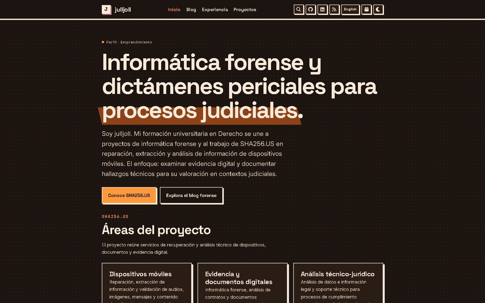
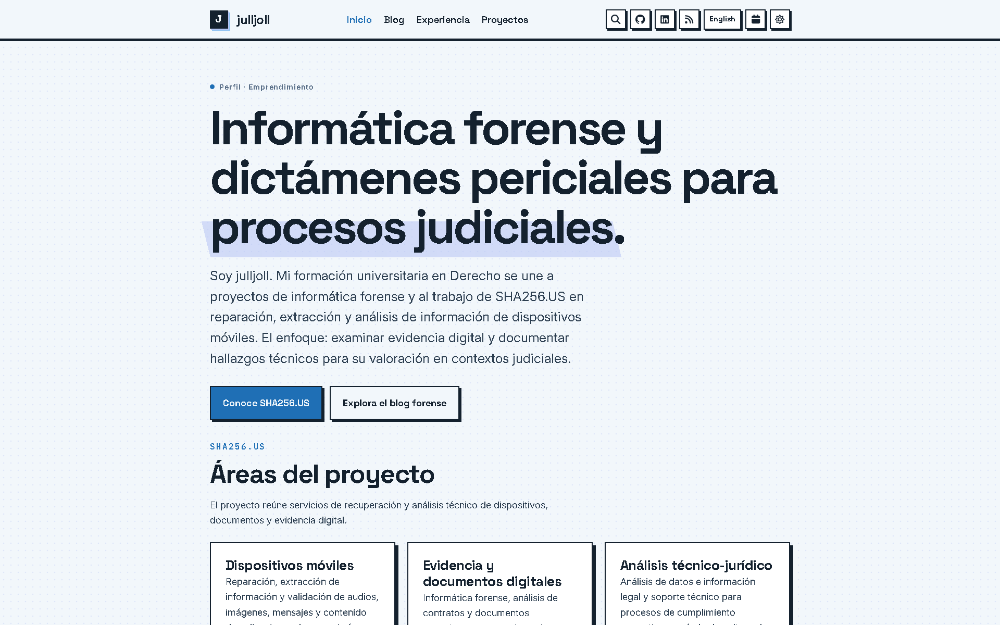
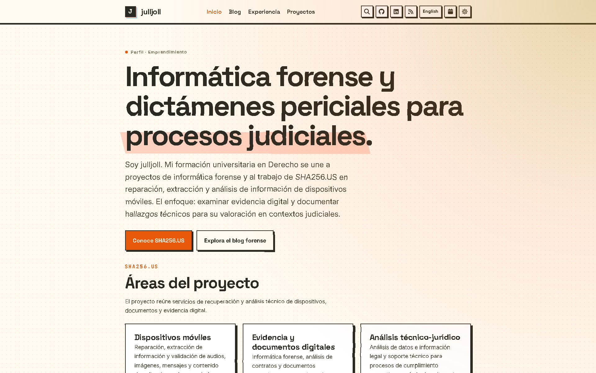
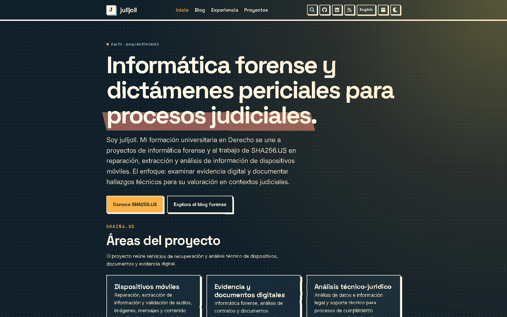

# julljoll — Perfil profesional

Sitio personal de **julljoll**, con formación universitaria en Derecho y proyectos de informática forense, cumplimiento y evidencia digital. Presenta el emprendimiento [SHA256.US](https://sha256.us/es/) y proyectos de software relacionados con documentación de evidencia y procesos judiciales. La portada está en español y la versión en inglés está disponible en `/en/`.

El sitio está construido con [Astro](https://astro.build/) y el tema estacional neobrutalista [Astro Seasons](https://github.com/nicomiguelino/astro-seasons): su paleta cambia según la estación y ofrece modos claro y oscuro. Consulta las [capturas del tema](#seasonal-theme).

## Perfil y proyectos

[SHA256.US](https://sha256.us/es/) se especializa en reparación y extracción de información de dispositivos móviles, además de análisis de evidencia digital. El [blog del proyecto](https://blog-astro-fawn.vercel.app/) describe trabajo relacionado con informática forense, documentos electrónicos, cumplimiento normativo y análisis de datos jurídicos.

El perfil incluye una Licenciatura en Derecho cursada en la Universidad Nacional Experimental de los Llanos Occidentales “Ezequiel Zamora”, Barinas (2005–2010), y experiencia complementaria en diseño gráfico, retoque de imágenes y edición de vídeo. Esta formación jurídica aporta contexto para documentar hallazgos técnicos; las competencias visuales ayudan a presentar los resultados, pero no sustituyen métodos forenses de autenticación. La habilitación para actuar como perito y la admisibilidad de un dictamen dependen de los requisitos legales y procesales de cada jurisdicción.

La [página de proyectos](/projects/) presenta estos repositorios:

- [Compliance Forensic](https://github.com/julljoll/Compliace-Forensic-js): CMS de cumplimiento forense para gestionar casos y evidencias, guiar procesos de cadena de custodia y producir documentos con auditoría SHA-256.
- [Ulpiano — Chief Compliance Officer](https://github.com/julljoll/Ulpiano-Chief-Compliance-Officer): propuesta y arquitectura de referencia sobre ciberseguridad procesal, integridad digital y cumplimiento.
- [JullBrain](https://github.com/julljoll/JullBrain): plataforma Legal-RAG en Python para organizar normativas, códigos y expedientes como conocimiento consultable.
- [FotoForense](https://github.com/julljoll/FotoForense): herramienta de apoyo para analizar posibles manipulaciones de imágenes y generar informes preliminares; sus resultados requieren validación pericial.
- [IPED_SHA256.US](https://github.com/julljoll/IPED_SHA256.US): repositorio relacionado con IPED, procesador e indexador de código abierto para analizar evidencia digital, desarrollado originalmente por especialistas de la Policía Federal de Brasil.

El español es el idioma principal en `/`; la versión en inglés está en `/en/`. El selector conserva la sección correspondiente y el tema recuerda las preferencias. Los metadatos están en `src/lib/site.ts`, las traducciones de interfaz en `src/lib/i18n.ts`, y las descripciones de proyectos en `src/lib/projects.ts`. Las publicaciones indican su idioma en el frontmatter y viven en `src/content/blog/`.

## Getting started

Install the dependencies and run the project:

```sh
npm ci
npm run dev           # dev server on :4321
npm run build         # production build
npm run preview       # preview the production build
npm run check         # astro type checking
npm run lint:check    # lint with ESLint
npm run lint:fix      # lint and apply safe fixes
npm run format:check  # check formatting with Prettier
npm run format:fix    # format files with Prettier
npm run test:e2e      # Playwright E2E and screenshot tests
```

> [!NOTE]
> `npm install` also sets up a Husky pre-commit hook that runs `lint:check`, `format:check`, and `check`. Fix failures before committing.

## Seasonal theme

The site switches palettes by date. Every family has a light and a dark variant, defined in `src/styles/palettes.css`:

- `neon-*`: not tied to a date, only available from the theme picker
- `autumn-*`: used from Sept 22 to Dec 21
- `winter-*`: used from Dec 22 to Mar 19
- `spring-*`: used from Mar 20 to Jun 20
- `summer-*`: used from Jun 21 to Sept 21

|        | Light                                              | Dark                                             |
| ------ | -------------------------------------------------- | ------------------------------------------------ |
| Autumn |  |  |
| Winter |  |  |
| Spring |  |  |
| Summer |  |  |

How it works:

- The family is picked from the visitor's local date on every page load, so no rebuild is needed when a season starts or ends.
- The mode (light or dark) comes from the theme toggle, falling back to `prefers-color-scheme`. Only the mode is stored (`site-mode` in `localStorage`), so a saved preference carries across seasons.
- The legacy `site-palette` value is migrated to `site-mode` and removed.
- `initializePalette()` in `src/lib/palette.ts` sets `data-palette` on `<html>`. `Layout.astro` calls it from `<head>`, and `body` stays hidden until the attribute is set (visible when scripting is off) to avoid a flash of the wrong colors.
- The theme toggle switches between light and dark within the active family.
- The theme picker in the navbar (before the light/dark toggle) overrides the date: Automatic (follow the date, the default), Autumn, Winter, Spring, Summer (under a "Seasons" divider), or Neon (under an "Other" divider). The choice is stored in `localStorage` as `site-theme` (removed for Automatic), and the matching falling effect follows it.

Autumn, winter and spring each have a falling effect on the home page (`FallingLeaves`, `FallingSnow`, `FallingPetals`). Summer has two ambient effects instead: `HeatShimmer` (an SVG displacement filter that makes the page content shimmer) and `Sunlight` (a pulsing warm glow in the top-right corner). Every effect is shown only under its palettes and when `prefers-reduced-motion` allows it.

To change the dates, edit `seasons` in `PALETTE_CONFIG` (`MMDD` numbers, inclusive; a range with `start` after `end` wraps the new year). To add a season, add it to `THEME_CHOICES` and the picker options in `src/components/header/ThemePicker.astro`, then add `[data-palette='<name>-light']` and `<name>-dark` blocks to `palettes.css`, add its name to `PaletteFamily`, and add its range to `seasons`.

To preview a season, set it in the browser console, e.g. `document.documentElement.dataset.palette = 'autumn-dark'`.

## Testing

Tests use [Playwright](https://playwright.dev) and live in `src/tests/`:

- `src/tests/e2e/`: behavior checks, e.g. the home page title
- `src/tests/screenshots/`: captures the home page in every season and the projects page in summer, in light and dark

Set up once per machine:

```sh
npx playwright install chromium
```

Then build and run. Playwright serves the production build with `astro preview` on port 4322, so it never collides with the dev server on :4321:

```sh
npm run build
npm run test:e2e                                        # everything
npx playwright test src/tests/e2e                       # E2E only
npx playwright test src/tests/screenshots               # screenshots only
npx playwright test --ui                                # interactive runner
npx playwright show-report                              # open the last HTML report
```

### Screenshots

- The home page is captured at 1920x1200 in light and dark, once for each season. The projects page is captured in summer only.
- The clock is pinned (July 15 for summer, Oct 15 for autumn, Jan 15 for winter, Apr 15 for spring), so results don't depend on today's date.
- The color scheme is emulated with `prefers-color-scheme`.
- Screenshots are written to `screenshots/` (overwriting the previous ones) and are not part of the deployed site. Names look like `home-autumn-dark.png` and `projects-summer-dark.png`.
- They are captured, not compared, so the tests don't fail on visual changes. Review the images in `git diff` before committing.
- To capture another page, create `src/tests/screenshots/<page>.spec.ts` that calls `defineScreenshotTests('<page>', '/<path>/')` from `./support`. Pass `[SUMMER_SEASON, AUTUMN_SEASON, WINTER_SEASON, SPRING_SEASON]` as a third argument to cover every palette.

The `Checks` workflow runs lint, format, and E2E as parallel jobs after a shared dependency setup, on pushes and pull requests to `main`. It can also be started manually.

## GitHub Pages

This repository is configured as a GitHub Pages user site at `https://julljoll.github.io/`. The deployment workflow builds at the domain root and runs on pushes to `main` or when started manually. Set **Settings > Pages > Source** to **GitHub Actions** to enable deployment.

If you instead deploy this project under a sub-path (for example, `https://<user>.github.io/<repo>/`), set two environment variables at build time:

```sh
SITE_URL=https://<user>.github.io BASE_PATH=/<repo> npm run build
```

`astro.config.mjs` passes them to Astro's `site` and `base` options. With neither set, the build is for a domain root.

Astro's `base` only rewrites URLs that Astro generates itself (stylesheets, scripts, and fonts referenced from CSS). Root-absolute paths you write by hand are not rewritten, so wrap them with `withBase()` from `src/lib/paths.ts`:

```astro
---
import { withBase } from '@/lib/paths';
---

<a href={withBase('/blog/')}>Blog</a>
```

This applies to `href`, `src`, and `fetch` URLs in `.astro` and `.ts` files. In Markdown, use relative links (for example `../markdown-features/`) so they work under any base. `withBase()` returns the path unchanged when there is no base.

## Customizing

Site-wide values (site name, author name, description, job title, site URL, and GitHub and LinkedIn profile links) live in `src/lib/site.ts`. The header, footer, page titles, RSS feed, search, and structured data read from it, and the letter in the header logo is the first character of `SITE_NAME`. Other content locations:

- `src/components/header/index.astro` and `src/components/Footer.astro`: navigation, header icons, footer
- `src/pages/index.astro` and `src/pages/en/index.astro`: Spanish and English profile home pages
- `src/components/experience/` and `src/pages/experience/index.astro`: the experience page. Each job is one component built on `ExperienceEntry.astro`. Rename, edit, or add components, then list them in `src/components/experience/index.astro`
- `src/lib/projects.ts` and `src/components/ProjectsGrid.astro`: bilingual project descriptions, focus labels, and repository links
- `src/lib/search.ts`: search entries for the static pages; keep project and profile summaries in sync with their pages
- `public/favicon.svg`: the tab icon, a static file that doesn't follow `SITE_NAME`, so replace it with your own
- `src/lib/palette.ts`: the seasonal palette logic and its config (storage keys, season dates); see [Seasonal theme](#seasonal-theme)
- `public/robots.txt`: the sitemap URL (a static file, so it can't import from `site.ts`). Crawlers only read `robots.txt` at the root of a domain, so it has no effect on a sub-path deploy
- `public/assets/og.png`: social preview image, 1200x630. It's a screenshot of the autumn home page, so replace it with your own

## Writing posts

Posts are markdown files in `src/content/blog/` with `title`, `description`, `date`, optional `tags`, and optional `draft` frontmatter. Each tag links to its archive page under `/tags/`. `markdown-features.md` shows the frontmatter and every supported markdown feature, and `make-it-yours.md` is a short customization guide. Delete both when you add your own posts.

## Project structure

```
src/
  components/     # reusable UI: layout, header, experience entries, project cards, page hero, post card, search, theme toggle
  content/blog/   # posts as markdown
  lib/            # post and tag helpers, project content, palette config, particle shapes, site constants
  pages/          # profile home, blog/, experience/, projects/, tags/, 404, rss
  styles/         # global styles, design tokens, palette definitions (Tailwind CSS)
  tests/          # Playwright specs: e2e/ and screenshots/
screenshots/      # committed screenshot baselines (not deployed)
public/
  assets/         # font, og image
```

## License

[AGPL-3.0-or-later](LICENSE).

This project is a modified version of [astro-palette](https://github.com/joshruggles/astro-palette) by Josh Ruggles, which is also licensed under AGPL-3.0-or-later. It was modified by Nico Miguelino in 2026. The changes include the season-aware themes and seasonal effects, the neobrutalist design, Tailwind CSS, Fuse.js search, the added pages and components, and the linting, formatting, and testing setup. The full change history is in this repository's git log.

If you deploy a modified version of this project as a website, [AGPL-3.0 section 13](https://www.gnu.org/licenses/agpl-3.0.html#section13) requires you to offer your users the corresponding source code, for example with a link to your repository in the site footer. The site name in the footer already links to the source; set `SOURCE_URL` in `src/lib/site.ts` to the repository that builds your site.

With thanks to:

- [astro-palette](https://github.com/joshruggles/astro-palette) by Josh Ruggles, the template this site was generated from (AGPL-3.0-or-later)
- [herdr](https://github.com/ogulcancelik/herdr) by Oğulcan Çelik, the website theme this one grew out of, and the reason it is AGPL-3.0-or-later
- Style: [Neubrutalism](https://neubrutalism.com/), the design style behind the hard borders, offset shadows, and bold colors
- Font: [JetBrains Mono](https://www.jetbrains.com/lp/mono/), under the [SIL Open Font License 1.1](https://github.com/JetBrains/JetBrainsMono/blob/master/OFL.txt)
- Icons: [Font Awesome Free](https://fontawesome.com/) icons, under [CC BY 4.0](https://creativecommons.org/licenses/by/4.0/)
- Search: [Fuse.js](https://www.fusejs.io) (Apache-2.0)
